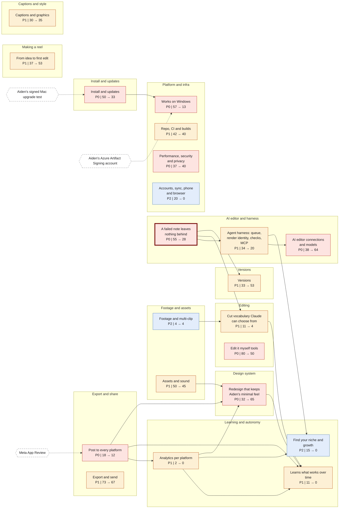
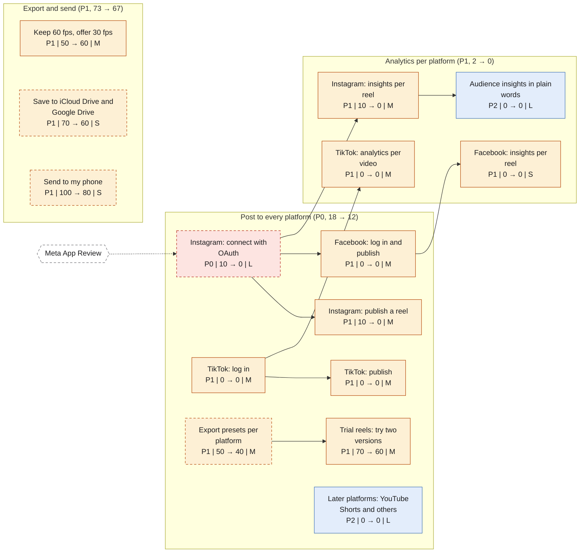
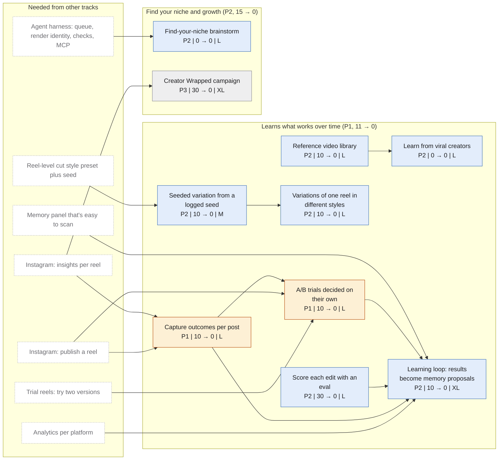
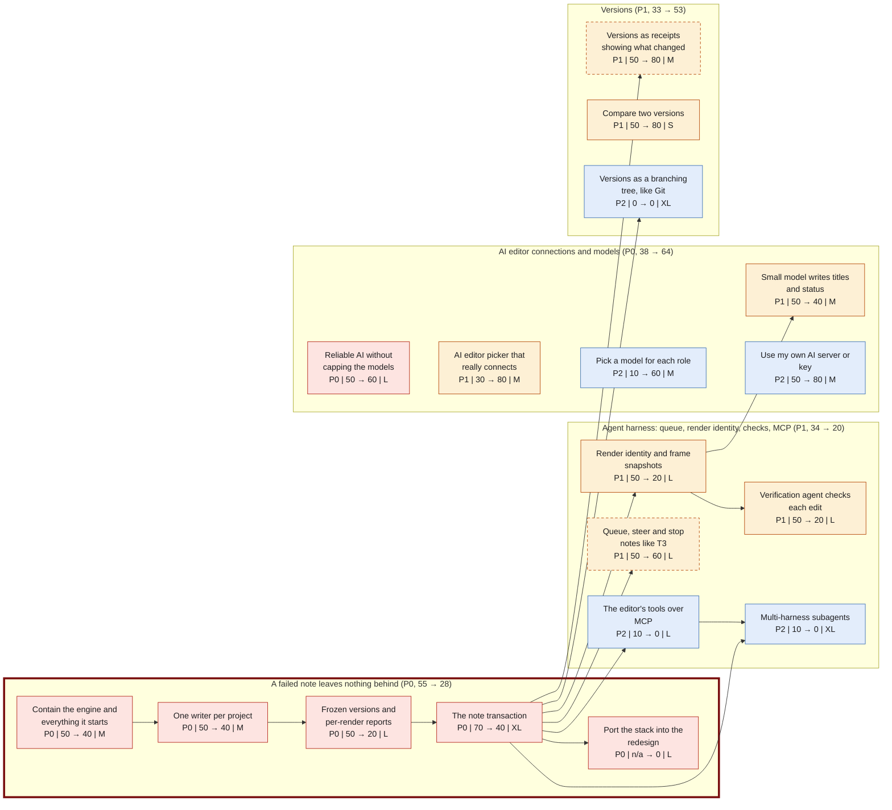
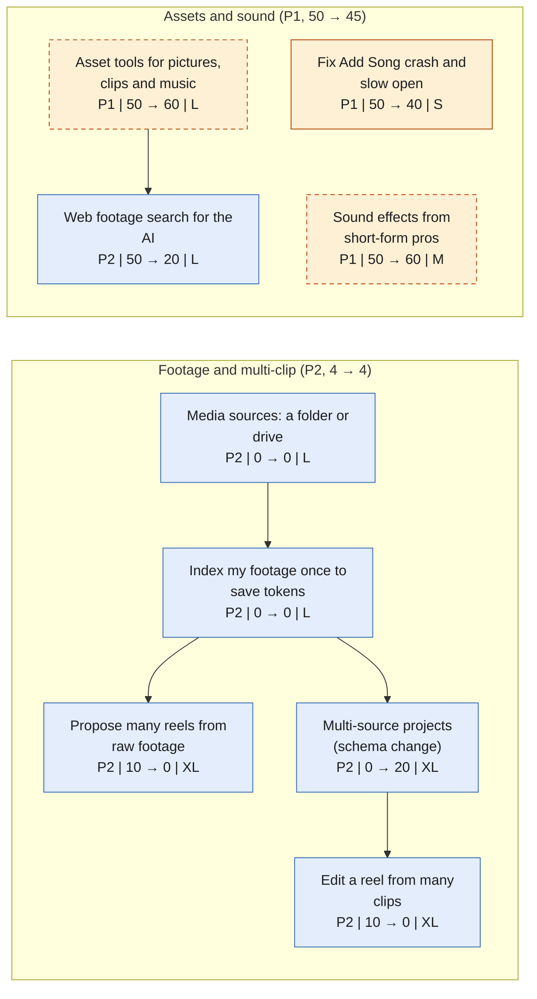
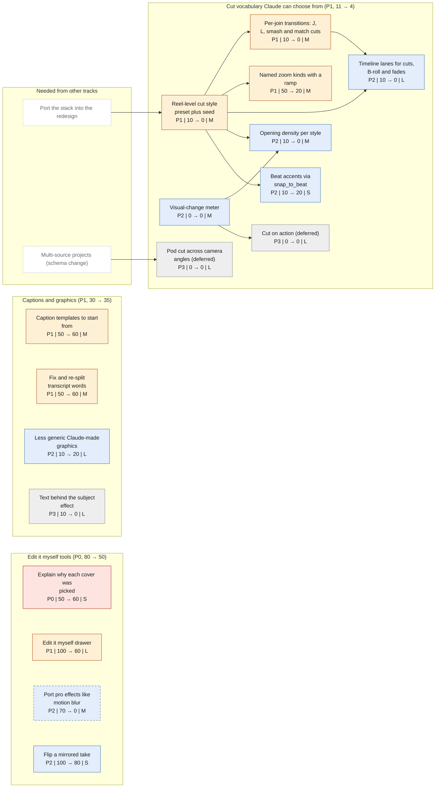
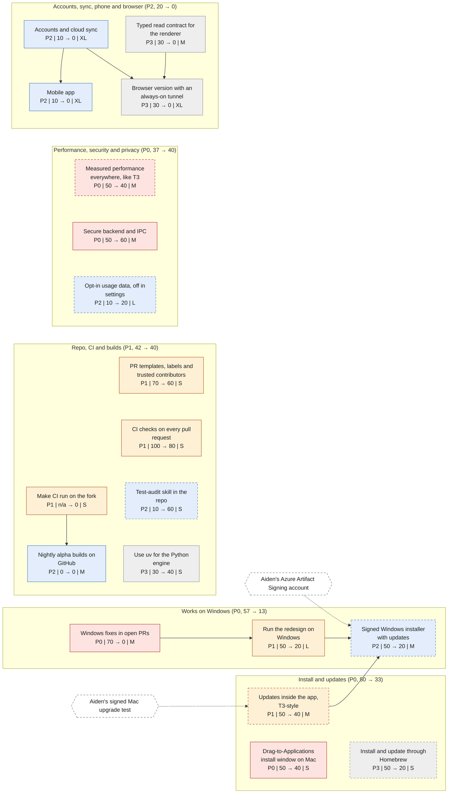

# Reel Studio roadmap graphs

Generated by `tools/build_roadmap.py` from `roadmap.json`. An arrow points from a prerequisite to the item that needs it.

## Overview: epics by area

## Publishing, export and analytics

## Learning and autonomy

## AI editor, harness and the failed-note stack

## Footage and multi-clip

## Cut vocabulary and editing

## Redesign screens

```mermaid
flowchart LR
    subgraph n_tasteful_redesign_g["Redesign that keeps Aiden's minimal feel (P0, 32 → 65)"]
        subgraph n_rd_notes_g["Notes thread (P0, 43 → 80)"]
            n_honest_progress["Honest progress for the<br/>first edit<br/>P0 | 50 → 80 | M"]
            n_change_at_moment["Point at a moment to<br/>request changes<br/>P2 | 50 → 80 | M"]
            n_clean_notes_thread["Simple notes thread with<br/>tool calls hidden<br/>P2 | 30 → 80 | M"]
        end
        subgraph n_rd_reel_g["Reel screen: player and timeline (P1, 38 → 52)"]
            n_focus_view["Big player view with live<br/>edits<br/>P1 | 30 → 60 | L"]
            n_instagram_preview["Faithful Instagram preview<br/>with my account<br/>P1 | 50 → 60 | M"]
            n_smooth_player["Smooth player with working<br/>scrubbing<br/>P1 | 50 → 80 | M"]
            n_fullscreen_reel["Watch the reel full<br/>screen, vertically<br/>P2 | 50 → 60 | S"]
            n_phone_full_height["Phone fills the whole<br/>height<br/>P2 | 30 → 80 | S"]
            n_speed_control["Playback speed in the<br/>player<br/>P2 | 30 → 80 | S"]
            n_device_shapes["Preview on different<br/>iPhone shapes<br/>P3 | 50 → 0 | S"]
            n_layout_choice["Let users choose single or<br/>double view<br/>P3 | 10 → 0 | M"]
        end
        subgraph n_rd_mystyle_g["My style (P1, 57 → 53)"]
            n_memory_panel["Memory panel that's easy<br/>to scan<br/>P1 | 50 → 40 | M"]
            n_remember_style["Remember my caption style<br/>for new reels<br/>P1 | 50 → 60 | M"]
            n_reference_import["Learn from my past edits<br/>elsewhere<br/>P2 | 70 → 60 | M"]
        end
        subgraph n_rd_onboarding_g["Onboarding (P1, 43 → 60)"]
            n_reuse_listening_model["Reuse a listening model<br/>already installed<br/>P1 | 50 → 60 | M"]
            n_first_run_permissions["Smooth T3-style<br/>permissions in first run<br/>P1 | 50 → 60 | M"]
            n_magical_onboarding["Magical first run with a<br/>live demo<br/>P1 | 30 → 60 | L"]
        end
        subgraph n_rd_visual_g["Visual system: pills, colour, type (P1, 25 → 60)"]
            n_better_logo["A better logo<br/>P1 | 10 → 40 | S"]
            n_pill_buttons["Pill buttons, no<br/>rounded-square clutter<br/>P1 | 10 → 60 | M"]
            n_intentional_motion["Intentional motion per<br/>Emil's guide<br/>P2 | 50 → 60 | M"]
            n_rd_tokens["Colour and type tokens<br/>P2 | 30 → 80 | S"]
        end
        subgraph n_rd_home_g["Home (P1, 30 → 70)"]
            n_home_card_states["Clear Paused and Didn't<br/>finish cards<br/>P1 | 30 → 60 | S"]
            n_activity_view["Activity view puts urgent<br/>reels first<br/>P2 | 30 → 80 | S"]
        end
        n_rd_insights["Insights screen<br/>P1 | 10 → 20 | M"]
        subgraph n_rd_settings_g["Settings (P2, 20 → 70)"]
            n_rd_settings_sections["Settings sections per spec<br/>§8<br/>P2 | 30 → 60 | S"]
            n_settings_search["Search in settings<br/>P2 | 10 → 80 | S"]
        end
        subgraph n_rd_shell_g["Shell and title bar (P2, 30 → 80)"]
            n_title_bar_alignment["T3-style title bar with<br/>aligned lights<br/>P2 | 30 → 80 | S"]
            n_rd_window["Window size and menu names<br/>P2 | 30 → 80 | S"]
        end
        subgraph n_rd_sidebar_g["Sidebar (P2, 30 → 80)"]
            n_sidebar_toggle["Collapsible sidebar<br/>P2 | 30 → 80 | S"]
            n_account_row_settings["Settings and AI editor in<br/>account row<br/>P2 | 30 → 80 | S"]
        end
        n_rd_library["Library screen<br/>P2 | 50 → 60 | M"]
        n_plain_wording["Cut redundant microcopy<br/>P2 | 30 → 80 | M"]
        n_share_menu["One Share menu for every<br/>destination<br/>P2 | 10 → 80 | S"]
    end
    subgraph n_ep_making_g["From idea to first edit (P1, 37 → 53)"]
        n_plan_in_chat["New reel opens a planning<br/>chat<br/>P1 | 30 → 60 | M"]
        n_drop_paste_airdrop["Drop, paste or AirDrop a<br/>video, animated<br/>P1 | 70 → 80 | S"]
        n_series_grouping["Group reels into series<br/>automatically<br/>P2 | 10 → 20 | M"]
    end
    subgraph other_g["Needed from other tracks"]
        n_asset_tools["Asset tools for pictures, clips and music"]
        n_ig_insights["Instagram: insights per reel"]
        n_instagram_posting["Instagram: connect with OAuth"]
    end
    n_instagram_posting --> n_instagram_preview
    n_remember_style --> n_memory_panel
    n_ig_insights --> n_rd_insights
    n_asset_tools --> n_rd_library
    n_plain_wording ~~~ n_share_menu
    n_honest_progress ~~~ n_change_at_moment ~~~ n_clean_notes_thread
    n_focus_view ~~~ n_smooth_player ~~~ n_fullscreen_reel ~~~ n_phone_full_height
    n_speed_control ~~~ n_device_shapes ~~~ n_layout_choice
    n_reuse_listening_model ~~~ n_first_run_permissions ~~~ n_magical_onboarding
    n_better_logo ~~~ n_pill_buttons ~~~ n_intentional_motion ~~~ n_rd_tokens
    n_home_card_states ~~~ n_activity_view
    n_rd_settings_sections ~~~ n_settings_search
    n_title_bar_alignment ~~~ n_rd_window
    n_sidebar_toggle ~~~ n_account_row_settings
    n_plan_in_chat ~~~ n_drop_paste_airdrop ~~~ n_series_grouping
    classDef p0 fill:#fde4e1,stroke:#b42318,color:#1d1d1f
    classDef p1 fill:#fdf0d5,stroke:#b54708,color:#1d1d1f
    classDef p2 fill:#e3edfb,stroke:#3b6fb6,color:#1d1d1f
    classDef p3 fill:#eeeeef,stroke:#8a8a8f,color:#1d1d1f
    classDef outside fill:#ffffff,stroke:#b0b0b5,color:#6b6b70,stroke-dasharray:2 2
    classDef blocker fill:#ffffff,stroke:#6b6b70,color:#1d1d1f,stroke-dasharray:5 4
    classDef waits stroke-dasharray:5 4
    classDef hardest stroke:#7a1010,stroke-width:4px
    class n_honest_progress p0
    class n_change_at_moment,n_clean_notes_thread,n_fullscreen_reel,n_phone_full_height,n_speed_control,n_reference_import,n_intentional_motion,n_rd_tokens,n_activity_view,n_rd_settings_sections,n_settings_search,n_title_bar_alignment,n_rd_window,n_sidebar_toggle,n_account_row_settings,n_rd_library,n_plain_wording,n_share_menu,n_series_grouping p2
    class n_focus_view,n_instagram_preview,n_smooth_player,n_memory_panel,n_remember_style,n_reuse_listening_model,n_first_run_permissions,n_magical_onboarding,n_better_logo,n_pill_buttons,n_home_card_states,n_rd_insights,n_plan_in_chat,n_drop_paste_airdrop p1
    class n_device_shapes,n_layout_choice p3
    class n_device_shapes,n_remember_style,n_reference_import,n_better_logo,n_drop_paste_airdrop waits
    class n_asset_tools,n_ig_insights,n_instagram_posting outside
```

## Platform and infra

